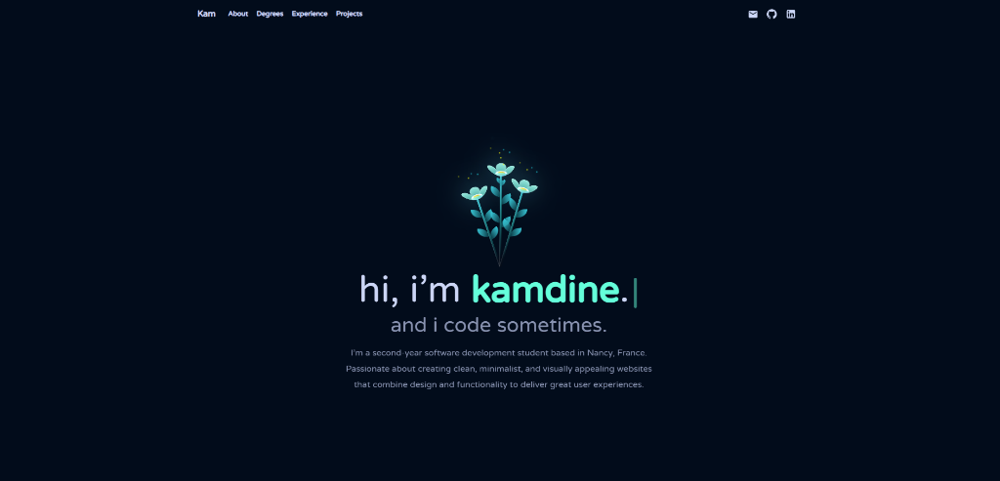

<div align="center">

# Portfolio

Portfolio de **Kamdine Hassanzadeh** — étudiant en BUT3 Informatique (parcours DWM) à l'IUT Nancy-Charlemagne.

</div>



## 🚀 Installation and Setup

1.  Clone the repository:
    ```bash
    git clone https://github.com/Kamdinee/portfolio.git
    cd portfolio
    ```

2.  Install dependencies
    ```bash
    npm install --legacy-peer-deps
    ```

3.  Start the project:
    ```bash
    npm start
    ```

## 🎨 Credits and Inspiration

This portfolio was inspired by the work of **Gazi Jarin**.

https://github.com/gazijarin/Gazi
